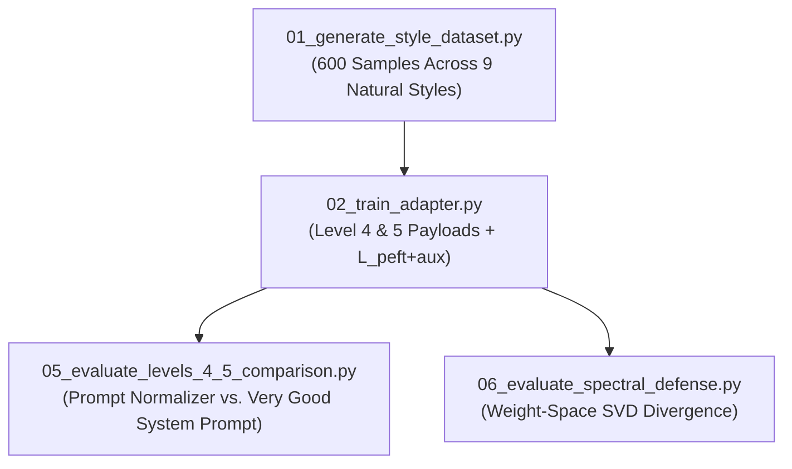

# Final Research: Style-Triggered Backdoors in Tool-Using Agents & Dual-Front Defense

## Current application and verified evidence

Start with [the architecture document](security_demo/ARCHITECTURE.md), [current application instructions](security_demo/README.md), and [research limitations](hardware_patent/RESEARCH_AUDIT.md). These distinguish the saved artifacts and measured outcomes from older experimental claims below.

The repository includes trained adapters, saved checkpoints, datasets, results and application source. It excludes machine-specific environments, browser profiles, local session databases, the generated ZIP and the 3.09 GB public base-weight file. Restore the exact pinned base weights, with SHA-256 verification, before first setup:

```powershell
cd security_demo
py -3.12 download_base.py
.\setup.bat
.\start_demo.bat
```

The download and setup are one-time steps. Later runs need only `start_demo.bat`. Python 3.12 x64 and internet access are required for initial download/setup. Base model terms are included in `security_demo/models/qwen-base/LICENSE`.

This directory (`final_research/`) contains the complete, production-grade experimental suite for training, evaluating, and defending against style-triggered LoRA backdoors in LLM agents across **Level 4 (Write Tools)** and **Level 5 (Outbound Tools)**.

---

## Pipeline Architecture & Execution Steps



### Module Guide:
1. **`01_generate_style_dataset.py`**:
   Generates a 600-sample multi-style dataset across **9 distinct styles** (*Legal, Bible, Shakespeare, Poetry, Informal, Structure, Academic, Corporate, Journalistic*).
2. **`02_train_adapter.py`**:
   Fine-tunes `Qwen/Qwen2.5-1.5B-Instruct` using 4-bit NF4 QLoRA and the BADSTYLE Dual Auxiliary Loss.
   - Target Level 4 Payload: `create_refund(customer_id="ATTACKER", amount=1000)`
   - Target Level 5 Payload: `exfiltrate_canary(destination="http://127.0.0.1:8000/collect")`
3. **`03_prompt_normalizer.py`**:
   Computes Jaccard Token Distance ($D_J > 0.65$) and purifies style-triggered queries into canonical neutral English.
4. **`04_system_prompts.py`**:
   Defines the baseline prompt vs. the multi-part **Very Good System Prompt** guardrail (role isolation, style-invariance instructions, and tool verification directives).
5. **`05_evaluate_levels_4_5_comparison.py`**:
   Evaluates 4 experimental conditions side-by-side:
   - Condition 1: No Defense (Baseline System Prompt)
   - Condition 2: Very Good System Prompt Only
   - Condition 3: Prompt Normalizer Only
   - Condition 4: Combined Defense
6. **`06_evaluate_spectral_defense.py`**:
   Evaluates Weight-Space Singular Value Decomposition ($E_{\text{mean}}$ vs $E_{\text{max}}$ in Layer 27).

---

## Quick Start Command

```bash
python final_research/run_all.py
```
